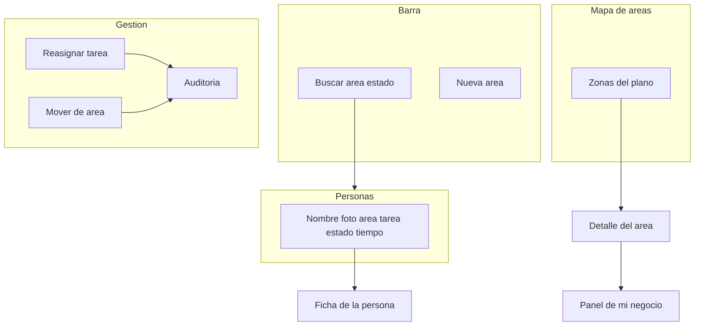

# Panel del dueño

HIVEX es un sistema operativo de capital humano en 2D. Cada empresa configura sus áreas y sus personas. El propietario (y cada director, dentro de su área) ve en el momento qué está haciendo cada uno y puede mover trabajo sin salir del panel.

La pantalla vive en `#/dueno`. El plano esquemático y la rejilla de áreas están en la misma vista. El rendimiento detallado sigue en `#/negocio` y la ficha de cada persona en `#/equipo/:id`.

## Regiones

```
┌ Escritorio ─────────────────────────────────────────────────────────┐
│ [Oficina] [Dueño] [Mi negocio] … [Plan] [Captación]                 │
│ Panel del dueño                                                     │
│ Qué está haciendo cada persona, en este momento.                    │
│ [Buscar] [Área ▾] [Estado ▾] [Ocultar plano] [Nueva área]           │
│ Personas ahora                                                      │
│ ┌ Martín Soto · Proveeduría · Buscando proveedores ─────────────┐  │
│ │ foto   En línea · 47 min en esta tarea                        │  │
│ │        [Rendimiento] [Mover]                                  │  │
│ └────────────────────────────────────────────────────────────────┘  │
│ ┌ Mapa de áreas ─────────────────────────────────────────────────┐  │
│ │  Ventas          Operaciones         Proveeduría               │  │
│ │  2 en línea      1 en línea          1 en línea                │  │
│ │  RR. HH.         Soporte              Marketing  Facturación   │  │
│ │  Logística       Finanzas             (el resto de zonas)      │  │
│ └────────────────────────────────────────────────────────────────┘  │
│ Áreas (tarjetas: aforo, quién está, zona del plano)                │
│ Detalle del área pulsada (personas + indicadores de hoy)           │
│ Tareas en marcha (arrastrar sobre una persona, o Reasignar)        │
│ Auditoría de los movimientos                                        │
└─────────────────────────────────────────────────────────────────────┘
```



## Componentes

- **Barra de filtros.** Texto libre (nombre, área o tarea), área y estado (`en línea`, `en reunión`, `en llamada`, `ausente`, `café`, `desconectado`).
- **Mapa de áreas.** Cada área activa es una zona. Muestra el nombre, cuántas personas tiene y cuántas están conectadas. Pulsar abre el detalle.
- **Tarjetas de persona.** Foto, línea `Nombre · Área · Tarea`, puesto, estado y tiempo en la tarea actual. Destino de arrastre para reasignar.
- **Tarjetas de área.** Misma información que el plano, en rejilla, para quien prefiere leer a escanear el mapa.
- **Tareas en marcha.** Título, área, responsable y estado. Se arrastran a una persona o se reasignan con el diálogo numerado.
- **Mover persona.** Diálogo con las áreas. Cambia el área de la ficha y queda en la auditoría. No mueve al propietario.
- **Nueva área.** Pide el nombre, crea el área y le asigna una zona libre del plano (sala existente o una banda abierta).
- **Auditoría.** Últimas acciones: reasignaciones, cambios de área, altas de área, cambio de plan y activación de Llamadas.
- **Enlaces.** «Rendimiento» abre la ficha. «Ver rendimiento del área» abre el panel de mi negocio.

## Tiempo real

El navegador abre un socket con la sesión. Al entrar en la oficina cada persona emite su posición y su estado. El servidor reúne esa presencia con la tarea actual (`currentTaskTitle` y `currentTaskSince`) y emite `panel:state`.

- El propietario recibe a toda la empresa.
- Un director recibe solo su área.
- Un empleado no recibe el panel (la API responde 403).

Si alguien no tiene el socket abierto, la tarjeta sigue mostrando su última tarea y el estado `Desconectado`. El tiempo de la tarea sigue contando desde que se le asignó.

## Escritorio y móvil

En escritorio la navegación es una fila de pastillas y el mapa cabe en una banda ancha. Las tarjetas de persona se colocan en varias columnas.

En móvil (por debajo de 860 px) la fila de pastillas se desplaza en horizontal, el plano crece en alto para que las zonas no se pisen al leerlas, y las columnas del tablero de tareas pasan a una sola. Desde la oficina, el botón **Gestión** abre el mismo menú. No hay una segunda aplicación: es la misma vista con el ancho de la pantalla.

## Acciones que quedan registradas

| Acción | Quién | Efecto |
|---|---|---|
| Reasignar tarea | Propietario o director de esa área | Cambia el responsable y la tarea actual |
| Mover de área | Propietario | Cambia el área de la persona |
| Crear área | Propietario | Crea el área y una zona del plano, si el plan lo permite |
| Cambiar plan | Propietario | Actualiza límites, sin cobro |
| Activar Llamadas | Propietario | Crea el área plantilla; el marcador sigue en «Próximamente» |

## Captación (preparada, no construida)

`#/captacion` muestra **Próximamente**. El propietario puede activar la plantilla de área **Llamadas**, que abre también una zona en el plano y dos indicadores (`llamadas`, `leads`). Los modelos `Lead`, `Call` y `Campaign` ya cuelgan de `companyId`.

Extensiones, sin implementar el tráfico real:

- `TelephonyProvider` en `apps/server/src/telephony.ts`: `placeCall`, `handleWebhook`, `assignLead`. Un adaptador de Zadarma o Twilio sustituye a `DisabledTelephonyProvider`.
- `PaymentProvider` en `apps/server/src/payments.ts` queda para Stripe. Hoy `ManualPaymentProvider` rechaza el cobro.

## Plan y uso

`#/plan` compara personas y áreas usadas con el tope del plan (`Starter`, `Pro`, `Empresa`). La API responde 409 en español si se supera el tope al invitar, importar o crear un área. Cambiar de plan no cobra.
